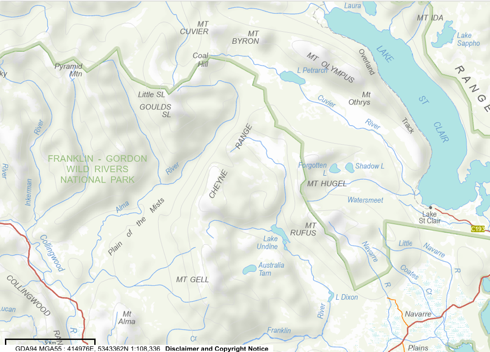
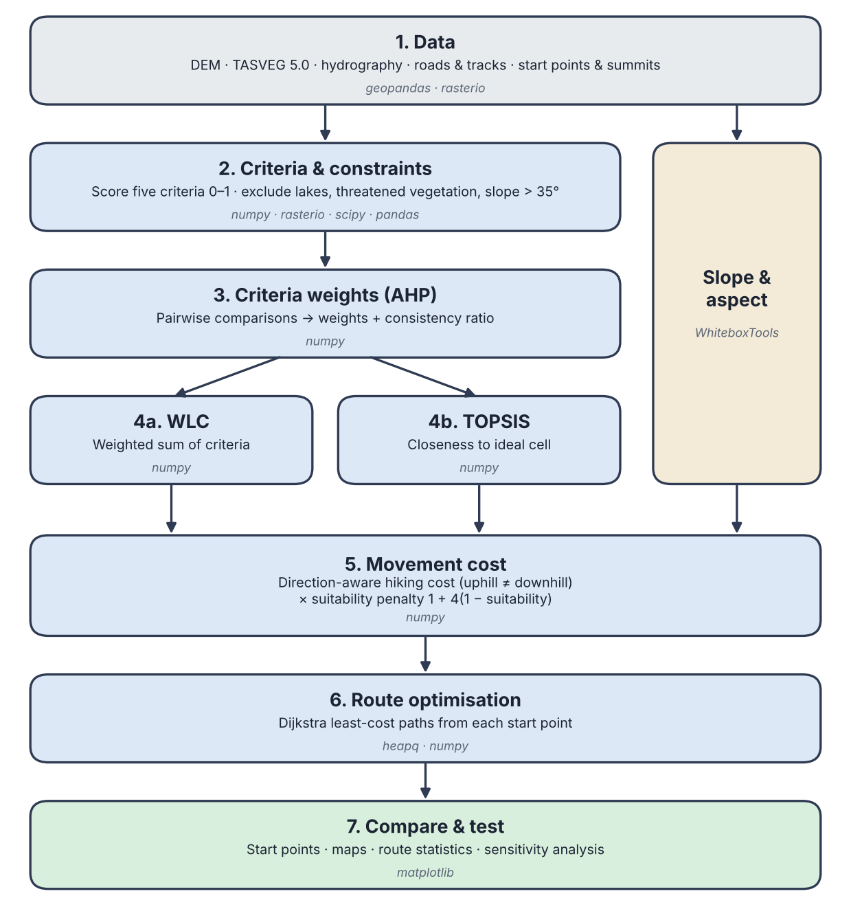

# Methods

## Study area



*Figure 1: Topographic map of the Cheyne Range and surrounds. Base map: LISTmap, © State of Tasmania (CC BY 3.0 AU).*

## Data sources

All datasets were clipped to a 17.5 × 13.5 km study area (the start, end and summit points plus a 1 km buffer), projected to GDA2020 / MGA Zone 55 (EPSG:7855) and converted to a common 10 m grid.

| Dataset | Source | Type / resolution | Used for |
|---|---|---|---|
| Tasmania Statewide 2 m Digital Elevation Model | Mineral Resources Tasmania / Land Tasmania, via theLIST | Raster, 2 m (resampled to 10 m by cell averaging) | Slope criterion and constraint, movement cost, elevation profiles |
| TASVEG 5.0 vegetation communities | Tasmanian Vegetation Monitoring and Mapping Program, NRE Tas, via theLIST open data service | Vector polygons, 1:25 000 nominal scale | Vegetation criterion, threatened community constraints, buttongrass (wet ground) |
| LIST Hydrographic Lines | Land Tasmania, via theLIST open data service | Vector lines | Distance-to-streams criterion |
| LIST Hydrographic Areas | Land Tasmania, via theLIST open data service | Vector polygons | Lakes and tarns (constraint), swamps and wet areas (wetland criterion), wide rivers (streams criterion) |
| LIST Transport Segments | Land Tasmania, via theLIST open data service | Vector lines | Distance-to-access criterion (roads and walking tracks) |
| Start/end access points and summits | Created by the authors in ArcGIS Pro from road ends, track heads and named peaks | Vector points | Route start, end and waypoints |

Threatened vegetation communities were identified by matching TASVEG 5.0 communities against Schedule 3A of the *Nature Conservation Act 2002* (Tas).

**Data limitations:**
- Approximately 65% of the statewide DEM is derived from LiDAR. The remainder is interpolated from photogrammetric contours and spot heights, with an effective resolution of 10 m
- TASVEG and threatened community mapping are indicative only and would require field verification.

LIST data © State of Tasmania, licensed under Creative Commons Attribution 3.0 Australia.

## Workflow overview
The analysis was written in Python, with each step saved as a raster on a common 10 m grid so the next step can read it. The scripts and notebooks are in the GitHub repository.



*Figure 2: Overview of the analysis workflow, with the main Python libraries used at each step.*

| Library | Used for |
|---|---|
| numpy | Array maths: criterion scores, AHP weights, WLC, TOPSIS and movement cost |
| pandas | Combining the stream line and stream area layers |
| geopandas | Reading and clipping the vector data (TASVEG, hydrography, transport, start points and summits) |
| rasterio | Reading and writing rasters, rasterising vector layers onto the 10 m grid, converting points to grid cells |
| scipy | Distance to streams and distance to access (`distance_transform_edt`) |
| WhiteboxTools | Slope and aspect from the DEM |
| heapq | Priority queue for Dijkstra's algorithm (Python standard library) |
| matplotlib | Maps and figures |

## Suitability criteria and constraints
The criteria is scored 0 to 1 with 1 being ideal.

- **Slope:** derived from the DEM starts at 1 up to 10 degrees then linearly falls to 0 at 30 degrees.
- **Vegetation:** derived from TASVEG 5.0, this is scored by individual vegetation groups.
  - Modified land: 1.0
  - Dry Eucalypt Forest and woodland: 0.9
  - Native Grassland: 0.8
  - Other natural environments (rocks): 0.7
  - Wet Eucalypt Forest, non-Eucalypt forest: 0.6
  - Moorland, rushland, buttongrass: 0.5
  - Highland treeless vegetation: 0.4
  - Scrub: 0.3
  - Wetland: 0.2
  - Alpine Coniferous Heathland: 0.1
- **Streams:** Derived from hydrographic lines and areas. 0 within 30m of water and rising to 1 at 100m.
- **Wetland:** Derived from hydrographic areas (swamps, buttongrass).
- **Access:** Derived from transport segments. 1 on a road or track.

Constraints:
- **Lakes and Tarns:** Track can not go over open water
- **Pencil Pine and King Billy Pine:** Threatened Vegetation
- **Sphagnum Peatland:** Threatened Vegetation
- **Cushioned Moorland, Highland Poa Grassland, Subalpine rushland:** threatened Vegetation
- **Steep Ground:** Slope > 35 degrees

Each criterion is rescaled to 0–1 with a simple linear function. For example, slope and distance to streams:

```python
# Slope: 1 up to 10 degrees, falling to 0 at 30 degrees
slope_score = np.clip((30 - slope) / (30 - 10), 0, 1)

# Streams: 0 within 30 m of a stream, rising to 1 at 100 m
stream_distance = distance_transform_edt(stream_cells == 0) * 10  # metres
stream_score = np.clip((stream_distance - 30) / (100 - 30), 0, 1)
```

`np.clip` keeps the scores between 0 and 1, and `distance_transform_edt` gives the distance from every cell to the nearest stream cell.

## Criteria weights (AHP)
The comparison matrix we chose to use is AHP. This uses a table with all the criteria ranked against each other on a scale of 1-9. It describes how much more important a row criterion is than the column criterion on Saaty's Scale. On the scale 1 means equal, 3 is moderate and 5 is strong. The scale goes up to 9 which is extreme but none of our criteria needs to be that strong over another. For example, Slope vs. Access, Slope is given a 5 over access because access is only a convenience while slope decides sustainability as well as how well the trail can be walked.
The script then takes this table and scales it to sum to 1.

- Slope: 0.407
- Vegetation: 0.249
- Streams: 0.143
- Wetland: 0.143
- Access: 0.059

| Criterion | Slope | Vegetation | Streams | Wetland | Access | **Weight** |
|---|:---:|:---:|:---:|:---:|:---:|:---:|
| **Slope** | 1 | 2 | 3 | 3 | 5 | **0.407** |
| **Vegetation** | 1/2 | 1 | 2 | 2 | 4 | **0.249** |
| **Streams** | 1/3 | 1/2 | 1 | 1 | 3 | **0.143** |
| **Wetland** | 1/3 | 1/2 | 1 | 1 | 3 | **0.143** |
| **Access** | 1/5 | 1/4 | 1/3 | 1/3 | 1 | **0.059** |

The weights are the principal eigenvector of the comparison matrix, scaled to sum to 1. The consistency ratio checks that the comparisons do not contradict each other and should be below 0.10:

```python
values, vectors = np.linalg.eig(AHP)
i = np.argmax(values.real)
weights = vectors[:, i].real
weights = weights / weights.sum()

consistency_index = (values[i].real - n) / (n - 1)
consistency_ratio = consistency_index / 1.12  # 1.12 = random index for 5 criteria
```

The consistency ratio of our matrix is 0.013.

## Suitability models (WLC and TOPSIS)
Two decision rules were used to combine the five standardised criteria into two suitability rasters. Both use the same criteria and the same AHP weights, this is so that any difference is because of the rules alone.

### Weighted Linear Combination (WLC)
This is the most widely used decision rule in GIS-based multicriteria analysis, with each cell's suitability being the sum of its criterion scores multiplied by their weights (Malczewski, 2006):

$$S = \sum_{i=1}^{n} w_i x_i$$

where $x_i$ is the score of criterion $i$ (0–1) and $w_i$ is its AHP weight. Because the weights sum to 1, the result is also between 0 and 1. WLC is compensatory: a high score in one criterion can make up for a low score in another, so a gentle slope can partly offset poor vegetation.

### TOPSIS
This ranks each option by how close each cell is to an ideal solution and how far it is from a worst-case solution (Hwang & Yoon, 1981). Each criterion is first multiplied by its weight ($v_i = w_i x_i$). The ideal point ($v_i^+$) takes the best value of every weighted criterion, and the anti-ideal point ($v_i^-$) takes the worst. For each cell, the distances to both are:

$$D^+ = \sqrt{\sum_{i=1}^{n} (v_i - v_i^+)^2} \qquad D^- = \sqrt{\sum_{i=1}^{n} (v_i - v_i^-)^2}$$

and suitability is the relative closeness to the ideal:

$$C = \frac{D^-}{D^+ + D^-}$$

$C$ is 1 for a cell that matches the ideal on every criterion and 0 for a cell that matches the worst case. Unlike WLC, a cell needs to be good across all criteria at once to score highly. Our criteria were already scaled 0–1, so no extra normalisation was needed, and the ideal and anti-ideal values were taken only from cells outside the constraints.

## Movement cost

movement cost was from a simple hiking cost fourmula where slope cost was based on the degrees*0.1 where slope was positive eg. 30 degrees has a cost weight of 0.3 and for negitive slopes the cost was assigned degrees*0.01 which makes downhill impact walking speed/effort less

importanly these implement a direction modifier which calculates the walkers apparrent slope rather then the global slope values, making this a anisotropic cost surface.

```python
# -1 when walking straight uphill, 1 when walking straight downhill
directional_modifier = np.cos(np.radians(angle_diff))

if directional_modifier < 0:  # uphill
    cost = 1.0 + (slope_deg * 0.1 * np.abs(directional_modifier))
else:  # downhill or across the slope
    cost = 1.0 + (slope_deg * 0.02 * (1 - directional_modifier))
```

`angle_diff` is the angle between the direction of travel and the aspect (downhill direction) of the cell.

## Path optimisation

for path optimisation Dijkstra algorithm was used, this finds the shortest path by slowly extending the, search and prioritising the least cost path to each node

due to the limitations of python and data storage the anisotropic cost surface does not exist in iteslf instead it is defined in the least cost path algorithm process, where the pathfinding can input the direction and calculate the cost.

The key step is where each move to a neighbouring cell is costed. Constraint cells are skipped, and the walking cost is increased on less suitable ground:

```python
if np.isnan(suitability_value):  # constraint cells cannot be entered
    continue

edge_cost = calculate_directional_cost(cell_slope, cell_aspect, move_dir) * dist_factor
totalcost = edge_cost * (1 + K * (1 - suitability_value))  # K = 4

new_cost = curr_cost + totalcost
if new_cost < best.get((nr, nc), float('inf')):
    best[(nr, nc)] = new_cost
    came_from[(nr, nc)] = (r, c)
    heapq.heappush(queue, (new_cost, nr, nc))
```

With K = 4, a step on the most suitable ground costs its walking cost only, while a step on the least suitable ground costs five times as much. `heapq` always expands the cheapest cell next, and `came_from` is used to trace the route back once the end point is reached.
