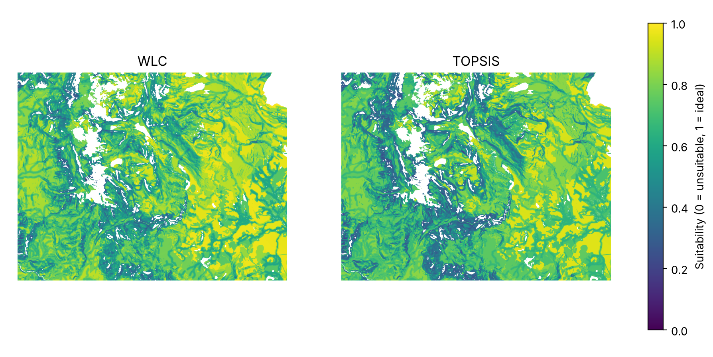
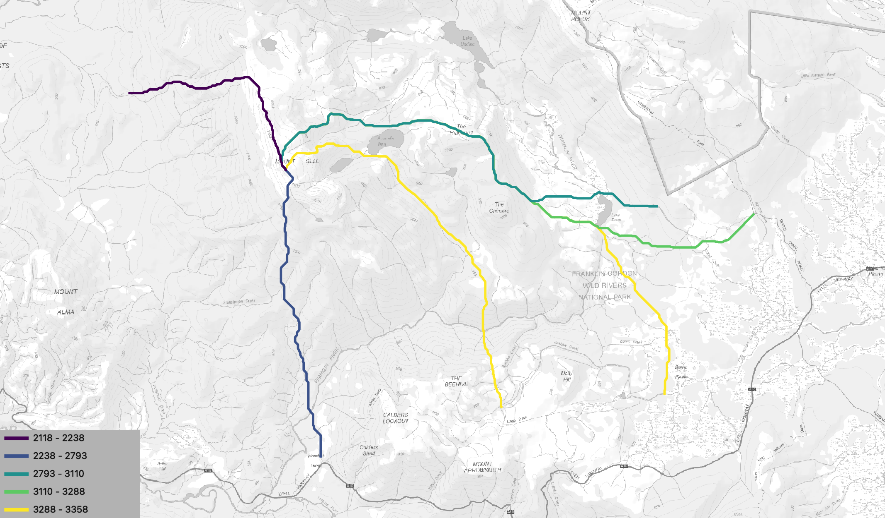
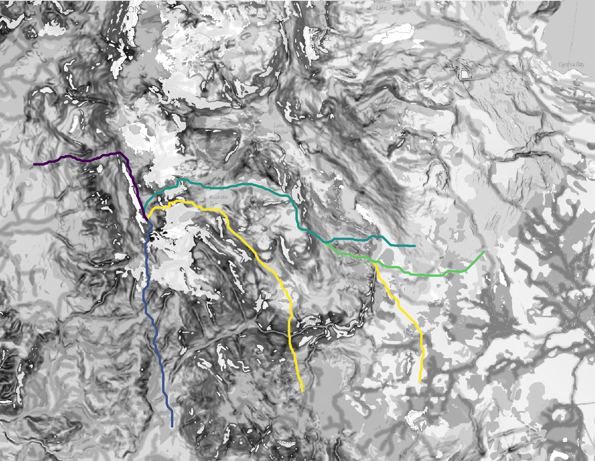
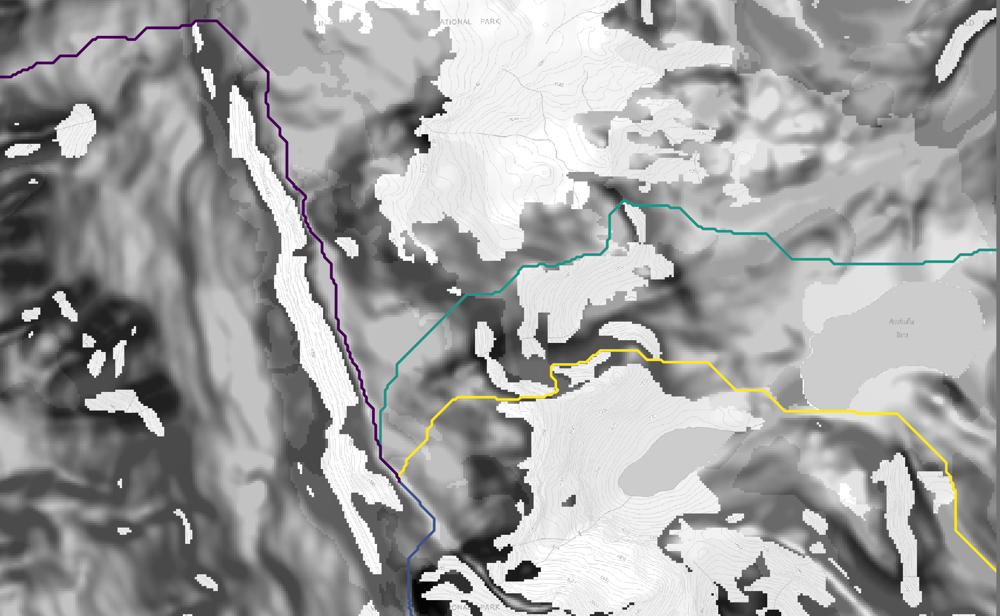
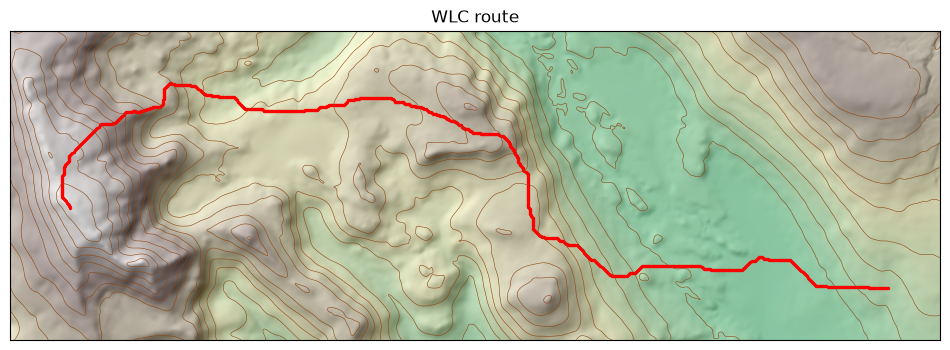
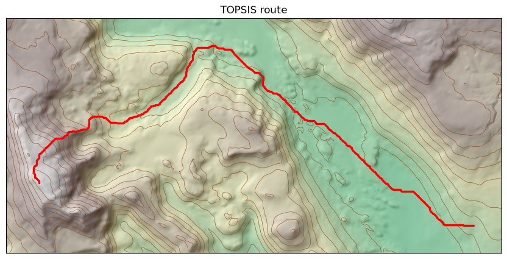
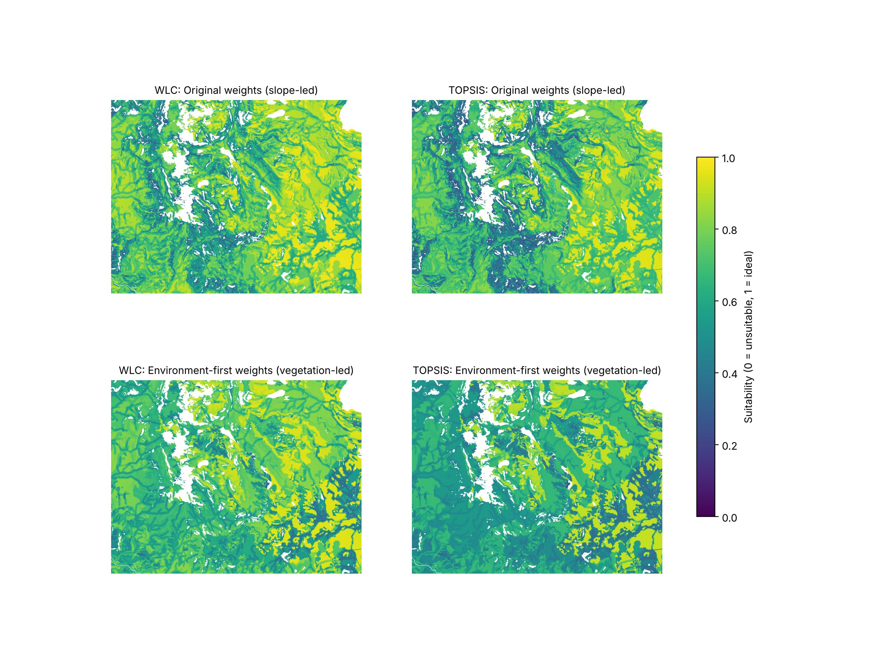
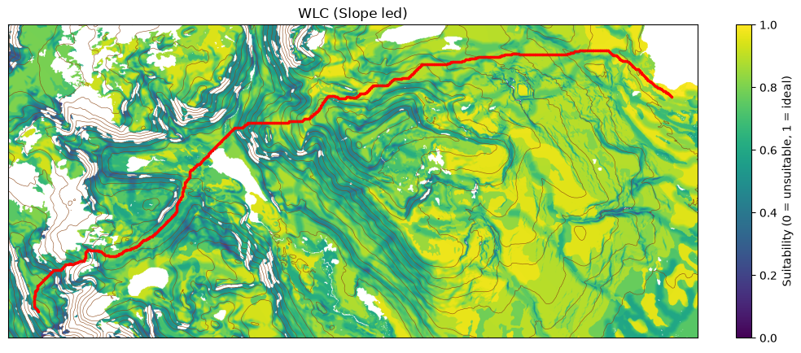
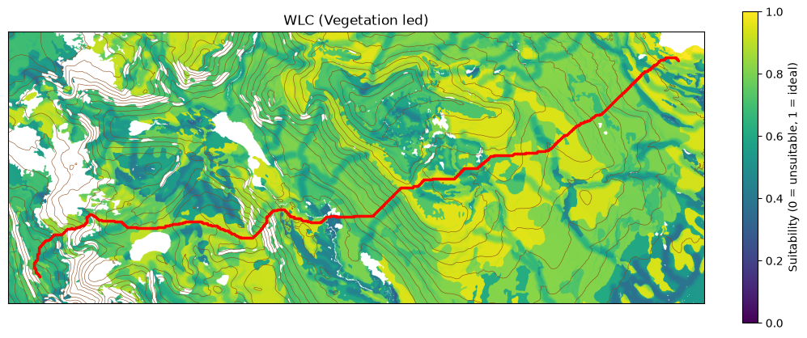
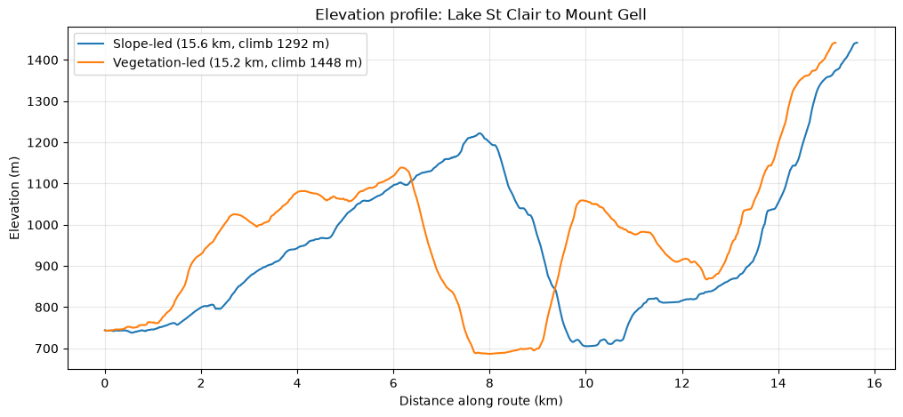

# Results

## Suitability surfaces

*Figure 3: Suitability for a walking track under WLC (left) and TOPSIS (right). White areas are excluded by constraints.*

There are some key differences when comparing the WLC and the TOPSIS suitability maps. The main one being that TOPSIS tends to make the suitability score lean towards 0. This is because if one cell has a bad score it pulls the whole cell down. This is not the case for WLC as one bad score can be made up if the other criteria are scored highly. 
Overall both suitability maps follow the same trends and the difference in routes will be shown in the next section.

## Routes

*Figure 4: Topographic map with routes shaded by cost. Base map: LISTmap, © State of Tasmania (CC BY 3.0 AU).*

*Figure 5: Least-cost routes from each start point over the suitability surface. White areas are excluded by constraints.*

*Figure 6: Close-up of where the routes meet near Mount Gell, passing between excluded (white) areas.*

To decide which route we would use for further testing it was due to the lowest cost but also which route looks like the most interesting trail. When the start point is Rufus Canal Road, the route passes the Chimera, goes over the Hippogriff and passes the Australia Tarn before finishing on Mount Gell.
This is where the subjective portion of trail modelling comes into play. Although there are routes that are cheaper coming from different start points, people would be much more inclined to hike a trail that passes through multiple points of interest. It also gives the opportunity for more people of all hiking levels to use the trail. Some may not want to hike all the way to the top of Mt Gell but would prefer to only go up the Hippogriff or the Tarn. This trail gives that opportunity to everyone and will be used in further comparisons. 

*Figure 7: Least-cost route from Rufus Canal Rd (right) to Mount Gell (left) on the WLC suitability surface, shown over shaded relief with 50 m contours.*

*Figure 8: The same route on the TOPSIS suitability surface.*

## Sensitivity analysis

To test how much the suitability surfaces depend on the AHP weights, both models were re-run with a second, vegetation-led set of weights (vegetation 0.445, wetland 0.262, streams 0.152, slope 0.089, access 0.052; consistency ratio 0.006).

*Figure 9: WLC (left) and TOPSIS (right) suitability under the original slope-led weights (top) and the vegetation-led weights (bottom). White areas are excluded by constraints.*

This drastically changes how the suitability raster looks and will perform. The vegetation led weighting prioritises the fragile alpine vegetation and causes the route to tend towards steeper ground.

*Figure 10: WLC route from Lake St Clair (right) to Mount Gell (left) with the original slope-led weights.*

*Figure 11: The same route with the vegetation-led weights. The background shows the suitability raster*

Here is an example of a modelled route using two different suitability rasters. Both suitability rasters were calculated using WLC with only the weights of the criteria changed. It shows the difference between the two rasters as well as key areas that each route leans towards. In Figure 11, the route goes down a pretty steep section that the slope led suitability raster weights pretty negatively. 

*Figure 12: Elevation profiles of the WLC routes from Lake St Clair to Mount Gell under the slope-led (blue) and vegetation-led (orange) weights.*

The elevation profile shows a similar pattern except that the vegetation led weights introduced ~150 metres of extra climbing.